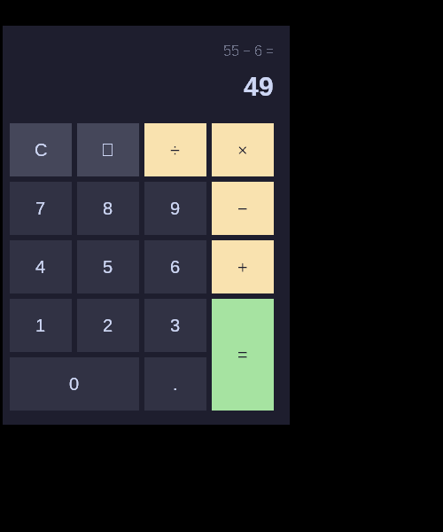

# Calculator (Windows / Win32)

A simple four-function calculator for Windows, written in C using the native Win32 API — the graphics layer built into Windows itself. Because it uses no external libraries, the compiled `calculator.exe` is a **true standalone**: a single file that runs on any Windows machine with nothing to install.

## Features

- Add, subtract, multiply, and divide
- Clickable buttons **and** full keyboard support
- A running expression line above the main display (e.g. `12 × 12 =`)
- Chained operations (e.g. `2 + 3 × 4`)
- Graceful handling of division by zero
- Backspace and clear
- Dark Catppuccin-style color scheme

## Screenshot



## Just run it

A prebuilt `calculator.exe` is included in this folder. On Windows, double-click it — that's all. It needs no installation and no Python, no GTK, no runtime.

> The `.exe` depends only on DLLs that ship with Windows (`USER32`, `GDI32`, `COMCTL32`, `KERNEL32`), so it runs on a clean machine out of the box.

## Building it yourself

You only need to do this if you change the source. Requires a C compiler with the MinGW Windows headers.

### On Windows (MinGW / MSYS2)

Install [MSYS2](https://www.msys2.org), then in the **MSYS2 MinGW 64-bit** shell:

```bash
pacman -S mingw-w64-x86_64-gcc
gcc calculator.c -o calculator.exe -mwindows -municode -lgdi32 -lcomctl32
```

### Cross-compiling from Linux

```bash
sudo apt-get install gcc-mingw-w64-x86-64
x86_64-w64-mingw32-gcc calculator.c -o calculator.exe \
    -mwindows -municode -lgdi32 -lcomctl32 -static
```

The `-static` flag folds the compiler's support libraries into the `.exe` so it stays a single self-contained file.

## Keyboard shortcuts

| Key | Action |
| --- | --- |
| `0`–`9`, `.` | Enter numbers |
| `+` `-` `*` `/` | Operators |
| `Enter` or `=` | Equals |
| `Backspace` | Delete last digit |
| `Esc` | Clear |

## How it works

The program keeps a little state: the number currently being typed (as text), a pending operator, and the stored first operand. Pressing an operator stores the current number and waits for the next; pressing `=` (or chaining another operator) evaluates the pending operation. This mirrors how a physical calculator behaves rather than parsing a whole expression string. The window, buttons, and dark color scheme are drawn directly with Win32 and GDI calls — the buttons are owner-drawn so they can carry custom colors.

## License

Released under the MIT License. See [LICENSE](LICENSE).
